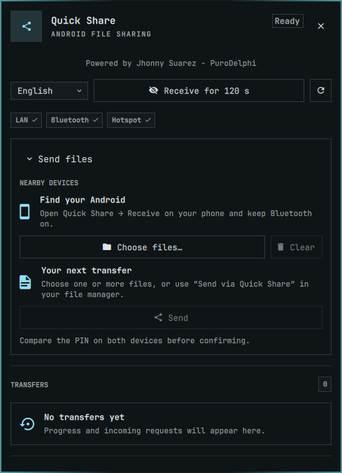

# Omarchy Quick Share

**Powered by Jhonny Suarez - PuroDelphi**

Send and receive files between Omarchy and Android's existing **Quick Share** interface. A standalone Rust user service handles discovery, encryption and transfers; a theme-integrated Omarchy plugin provides the bar widget, consent panel and notifications. Nautilus adds **Send via Quick Share** for one or multiple local files. No companion Android app is required.

Repository: [PuroDelphi/omarchy-quickshare](https://github.com/PuroDelphi/omarchy-quickshare).



The idle preview is captured from the real theme-integrated panel; it contains no device identifiers, private paths or verification codes.

## Status and scope

This is a working integration with **incomplete transport and compatibility validation**, not a universal Android compatibility claim or a marketplace approval.

| Area | Recorded result |
| --- | --- |
| Native Android LAN transfers | Both directions, small/64 MiB files, batches and Unicode names approved; selected Android copies independently verified through USB/MTP. |
| Native Bluetooth transfers | Both directions completed under documented conditions; a received photo has matching independent Android SHA-256. Native 64 MiB transfers with Wi-Fi off on **both** devices are approved in **both directions**, with independent Android source/destination SHA-256 and byte equality. Bluetooth cancellation/disconnection and outgoing batches remain pending. |
| Desktop integration | Native consent/notification with panel closed, Nautilus single/multi-file sends, LAN cancel/reject and active shell reload approved. English/Spanish preference persistence verified. |
| Routerless Wi-Fi | NetworkManager hotspot creation/restoration tested locally; native Android negotiation and bidirectional files remain unvalidated. |
| Known negatives | Native empty-file send failed. Android retained a public partial after an abrupt radio disconnection; remote cleanup is not approved. |
| Lifecycle | Source/package install, update, remove/reinstall and automatic startup after a real reboot/new graphical login verified; Spanish, configuration and recorded received-file metadata preserved. |

The complete requirements, phases and acceptance matrix remain in [IMPLEMENTATION_PLAN.md](IMPLEMENTATION_PLAN.md). Detailed positive and negative evidence is in [docs/VERIFICATION.md](docs/VERIFICATION.md). Already approved basic transfers and UI cases do not need repeating merely because documentation changes.

## Requirements

Target: Linux/Arch with Omarchy and Quickshell. Recorded desktop baseline: Omarchy 4.0.4, Quickshell 0.3.1. Other versions and adapters are not certified.

- **Runtime:** session D-Bus, systemd user services, BlueZ for Bluetooth, NetworkManager and `dnsmasq` for hotspot operation, `jq`, and Omarchy/Quickshell.
- **File chooser:** `xdg-desktop-portal` with a backend implementing FileChooser, such as `xdg-desktop-portal-gtk`.
- **Nautilus integration:** `nautilus`, `nautilus-python`, `python-gobject`, `gtk4`.
- **Source/package build:** Rust/Cargo, `protobuf` (`protoc`), `pkgconf`, D-Bus development files; Arch packaging additionally needs `base-devel`/`makepkg` and `git` for cloning.

NetworkManager starts its own `dnsmasq` instance for shared IPv4. Do **not** enable `dnsmasq.service` for this project. A radio capability flag is not proof of Android interoperability. Permission to interrupt an existing Wi-Fi connection starts off and is not retained across daemon runs.

## Install

The canonical Omarchy plugin is the root [manifest.json](manifest.json), root QML files and `nautilus/` module, with stable plugin ID `macondo.quickshare`. The Rust daemon is a **separate required dependency**: adding only the plugin cannot build or install the transfer service. A marketplace/plugin installation alone is not a working transfer setup; use one of the complete setup paths below, not two parallel daemon installations. Setup writes project-owned user resources, not Omarchy's package-owned desktop files.

### From source

Clone the repository, open a terminal in its directory, then run **as the desktop user, without sudo**:

```bash
git clone https://github.com/PuroDelphi/omarchy-quickshare.git
cd omarchy-quickshare
./scripts/install.sh
```

The installer builds with `Cargo.lock`, validates the plugin, installs `~/.local/bin/omarchy-quickshare`, a systemd user unit and the user plugin. It respects `XDG_CONFIG_HOME` and `XDG_DATA_HOME` for project configuration/data. It preserves a previous owned plugin as a backup and refuses to overwrite unowned destinations. Ensure `~/.local/bin` is in the **graphical session's** PATH, not just a terminal's.

### Local Arch package

```bash
./scripts/build-package.sh
```

This creates a local package in `dist/` and a source snapshot plus checksum-bearing PKGBUILD in `dist/source/`; it is not a promise of a published release or AUR package. Install the generated `.pkg.tar.zst` with `sudo pacman -U` using its actual filename. Then, as the desktop user:

```bash
omarchy-quickshare-setup
```

Packaged setup uses `/usr/bin/omarchy-quickshare`. `./scripts/setup-packaged.sh` is the corresponding repository script. Updates require transfers to finish or be explicitly cancelled before replacing the running service.

### Omarchy marketplace

The repository contains exactly one root manifest and uses the stable deployed ID `macondo.quickshare`; installation keeps existing inline preferences. Follow the [official publishing guide](https://plugins.omarchy.org/publish.html) and [submission contract](https://github.com/omacom/omarchy-plugin-marketplace/blob/main/SUBMISSION.md).

This plugin requires the separate Rust backend and Nautilus registration. Omarchy's standard Git plugin installer does **not** install these dependencies or run this project's setup scripts. A marketplace listing therefore needs the curator's **manual-setup** classification and the complete installation instructions above. Native plugin updates alone also do not update the daemon. No marketplace approval or listing is claimed.

### After either setup

```bash
systemctl --user status omarchy-quickshare.service
omarchy-quickshare status
```

Visibility starts **off**. An already-running Nautilus process must be restarted to load a newly installed or updated Python extension. Save work in all of its windows before `nautilus --quit`, then reopen it; another window in the same process does not reload the module. Setup does not close your file-manager windows automatically.

## Use

1. Open Quick Share from the bar widget.
2. For receiving, choose **Receive for 120 s**. On Android, select files, then Share → Quick Share → the displayed computer.
3. Compare the verification code on both devices and explicitly accept or reject. Sending from Omarchy also requires local code confirmation and remote acceptance.
4. To send from the panel, select a discovered device, choose files and press **Send**. Watch confirmed transport and byte progress; use **Cancel** to stop.
5. Alternatively, select local files in Nautilus and choose **Send via Quick Share**. This only prepares the panel: it does not send or accept automatically. A single discovered destination is preselected; multiple destinations require a choice. A vanished manual choice is cleared, never redirected to another device.

Closing the panel does not cancel transfers. The daemon continues independently of shell reloads. The panel uses Omarchy's theme tokens, and its persistent **English / Español** selector controls the panel, bar, project Nautilus menu and new notifications. The preference is saved in the inline `macondo.quickshare` entry of Omarchy's `shell.json`, preserving unrelated fields. File/device names and technical errors remain unchanged.

Folders, remote locations and unsupported mixed selections do not offer the Nautilus action. Local paths with spaces/Unicode are passed as separate arguments; the complete selection is checked, with a 1,000-file limit.

**Direct Wi-Fi consent:** leave **Allow interrupting my Wi-Fi for a direct connection** off unless you authorize a temporary interruption. Some adapters cannot run AP and station modes together. Android routerless behavior remains under validation; permission is not a transport guarantee.

### CLI

```bash
omarchy-quickshare doctor
omarchy-quickshare status
omarchy-quickshare watch
omarchy-quickshare visible 120
omarchy-quickshare visible 0
omarchy-quickshare network-consent on
omarchy-quickshare network-consent off
omarchy-quickshare share -- "$HOME/Downloads/example file.txt"
```

`share` prepares the panel. `send DEVICE_ID FILE...` requests a transfer; `accept TRANSFER_ID`, `reject TRANSFER_ID` and `cancel TRANSFER_ID` act on IDs returned by status/watch. `download-dir DIRECTORY` selects an existing absolute destination; `pick-files` opens the portal chooser (cancellation returns `[]`). `watch` emits an initial snapshot and NDJSON changes; it exits when service ownership changes, and the plugin reconnects to recover state.

For controlled transport investigation, `serve` supports `--port`, `--download-dir`, `--no-lan`, `--no-bluetooth` and `--no-hotspot`. Never run a second daemon alongside the installed service: only one may own the session D-Bus name.

## Architecture and safety

- Standalone Rust/Tokio daemon with the vendored rquickshare-derived core; no protocol execution or cryptographic keys in QML.
- Session D-Bus: service `io.omarchy.QuickShare`, object `/io/omarchy/QuickShare`, interface `io.omarchy.QuickShare1`. The plugin uses the CLI and snapshot stream, not a second engine.
- LAN TCP (default port **47593**) and mDNS; Classic/BLE discovery and RFCOMM file data through BlueZ. BLE/GATT provides discovery metadata, **not file transport**.
- UKEY2/P-256, authenticated encryption/MAC and sequence checks, explicit consent and verification-code comparison. Names/sizes are introduced before acceptance to support the receiver's consent UI.
- Private temporary receive files, size/offset/name validation, publication without overwriting existing files, and local partial cleanup on cancellation/failure. A local terminal status does not certify Android's private-cache or public-file cleanup.
- Encrypted WPA2 hotspot negotiation and temporary NetworkManager profiles; native Android routerless acceptance remains open. No claimed Wi-Fi Direct/P2P, WPA3, 6 GHz, contact/account identity or lossless resume.

Scope firewall rules to trusted interfaces/networks and the actual transport. Do not globally disable a firewall, grant unrestricted polkit permissions or post credentials to troubleshoot discovery.

## Troubleshooting and development

```bash
journalctl --user -u omarchy-quickshare.service
omarchy-quickshare doctor
```

Redact diagnostics before sharing: adapter/device addresses, private paths, SSIDs, credentials and verification codes must not appear in public issues. `doctor` checks local tools/radios/permissions; it is not an Android transfer test. See [CONTRIBUTING.md](CONTRIBUTING.md) for build/check commands and evidence expectations, and [SECURITY.md](SECURITY.md) for vulnerability handling.

## Uninstall

Source installation, from the checkout:

```bash
./scripts/uninstall.sh
```

Packaged installation, without a checkout:

```bash
omarchy-quickshare-uninstall
sudo pacman -R omarchy-quickshare
```

The user uninstaller asks for confirmation, stops/disables the service, unloads/removes only project-owned user resources and its Nautilus link, and preserves downloads, configuration, plugin backups and inactive inline language/layout preferences. Package-owned system files must be removed with pacman; avoid `-Rs` to retain shared dependencies.

Native `omarchy plugin remove` removes the plugin and its Nautilus integration, but **also deletes inline preferences** and does not uninstall the daemon/package. Use the project's uninstaller to preserve the language on reinstall. Nautilus may cache a stale label until the selection changes; an absent plugin cannot authorize sharing.

## License and provenance

Original project code is licensed under [MIT](LICENSE), copyright **2026 Jhonny Suarez - PuroDelphi**. Third-party components retain their own licenses:

| Component | License |
| --- | --- |
| Original root `src/`, QML/plugin integration, `nautilus/`, scripts and documentation | [MIT](LICENSE) |
| Vendored rquickshare core, including this project's modifications | [GPL-3.0-only](vendor/rquickshare/LICENSE), except separately licensed schemas below |
| Google protobuf schemas | [Apache-2.0](vendor/rquickshare/LICENSE-APACHE), with retained file headers |
| Chromium protobuf schemas | [BSD-3-Clause](vendor/rquickshare/LICENSE-CHROMIUM), with retained file headers |
| Other locked dependencies | Their respective licenses in [THIRD_PARTY_NOTICES.txt](vendor/THIRD_PARTY_NOTICES.txt) |

The core derives from [rquickshare](https://github.com/Martichou/rquickshare), revision `378d8ae969941bee4bf60ad34ac9cf8bb7005eb7`. **The combined daemon binary is not MIT-only:** distributing it carries GPL-3.0-only obligations, including providing corresponding source and preserving applicable license/attribution notices. MIT licensing of original code does not relicense the vendored core.

Update dependency notices with `./scripts/update-notices.sh` when dependencies change. No Rust code from rustdrop or SimpleNearby was copied where a usable license was absent.

This is an independent project, not an official Google/Android or Omarchy product. Quick Share and other product names belong to their respective owners.
